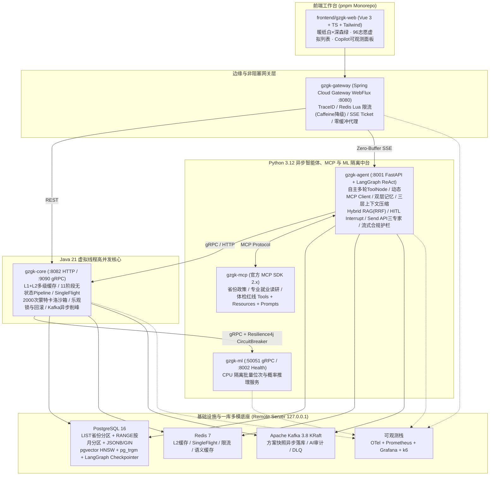

# GZGK v2.0 全面重构架构蓝图：Java 21 高并发引擎 × LangGraph ReAct + MCP 智能体平台

> **项目定位**：面向高考出分潮汐洪峰的高并发智能志愿决策平台（分布式高并发核心引擎 + 企业级自主 Multi-Agent 架构）  
> **技术主线**：Java 21 (Virtual Threads) + Spring Cloud Gateway (WebFlux) + PostgreSQL 16 一库多模（声明式分区 + `JSONB/GIN` + `pgvector` HNSW）+ Redis 7 + Kafka 3.8 KRaft + Python 3.12 LangGraph ReAct & 官方 MCP Server/Client + Vue 3 AI-Native 工作台

---

## 一、重构目标与核心技术挑战

针对 v1 旧版架构存在的 **JVM 同步阻塞调 LLM、4,000 行大事务占满 Hikari 连接池、96 志愿 N+1 查询、缓存指纹拼入 `userId/clientIp` 无法复用、伪 RAG** 等架构债，v2.0 围绕高考出分期四大真实工程难题进行彻底重构：

1. **极端潮汐流量 + 同分热点聚集**：出分 72 小时 QPS 暴涨，同省同分同位次考生高度重叠 → 采用 **L1 Caffeine + L2 Redis + 业务规范化指纹 + 分布式 SingleFlight（64:1 并发合并）**。
2. **短请求计算与长连接 IO 物理隔离**：百毫秒级推荐计算与 30~90s LLM SSE 长连接隔离 → **WebFlux 非阻塞零缓冲网关 + Java 21 虚拟线程 + 跨语言进程边界 + Resilience4j 舱壁熔断**。
3. **确定性算法与非确定性 Agent 闭环**：严禁 LLM 凭记忆编造分数线 → **自主 ReAct Agent (`bind_tools` ↔ `ToolNode`)** 通过 gRPC 回调 Java 确定性查数引擎与 **2000 次蒙特卡洛沙箱**，并经 **LangGraph `interrupt / resume` (HITL)** 由考生确认后再以乐观锁写入方案。
4. **生产级 Agent 工程能力**：标准 **MCP Server (`mcp` SDK 2.x) + 动态 MCP Client 挂载**、**双层记忆**（短时 Checkpointer + 跨会话长期考生偏好 `LangGraph Store`）、**三层上下文压缩**（`tiktoken` 预算 + 旧工具输出裁剪 + 保护 `AIMessage(tool_calls)/ToolMessage` 原子边界的 `RemoveMessage` 滚动摘要）与 **12 字符滑动窗口流式合规拦截**。

---

## 二、总体系统架构与五进程运行时边界



---

## 三、核心模块技术要点

### 1. Java 21 高并发核心引擎（`backend-java/`）
- **模块化单体 + ArchUnit 强制包边界**：`catalog`、`scoreline`、`policy`、`mq` 严禁逆向依赖 `recommend`、`sandbox`、`grpc`，由 `ArchitectureBoundaryTest` 自动化守卫。
- **11 阶段无状态推荐 Pipeline**（`RecommendPipelineService`）：彻底去除外层 `@Transactional`；剥离 `userKey/clientIp` 生成完整业务 SHA-256 指纹实现跨考生缓存共享；批量 `IN` 富化把 96 次 DB 往返压成 2 次；自适应位次窗口扩展确保高分头部考生也能稳健生成满额 96 志愿。
- **分布式 SingleFlight**（`DistributedSingleFlight`）：单机 `CompletableFuture` 合并（64 虚拟线程并发实测 64:1 合并，零 `Thread.sleep` 轮询）+ Redis 分布式协调 + 随机 TTL 抖动防雪崩。
- **Resilience4j 熔断降级**（`MlGrpcClientFacade`）：gRPC 调用 `gzgk-ml` 设 300ms 超时与 30% 失败率熔断，异常无缝降级至 7 万样本回测验证过的 `LogRankChanceModel`（Brier `0.0155`）。
- **确定性沙箱与乐观锁回滚**（`PlanSandboxService`）：`simulate` 纯内存无副作用跑 2000 次蒙特卡洛 Diff；`applyMutation` 通过 `expectedVersion` 乐观锁更新（冲突返回 409）并记录变更栈支持一键回滚。

### 2. PostgreSQL 16 一库多模数据底座（`db/migration/V1..V4`）
- `data_major_score_line`：**声明式 `LIST (province_code)` 分区**（GZ/SC/HB/AH/GX/HI/YN/HA/DEFAULT），查询精准触发 Partition Pruning。
- `biz_plan_history` & `ai_audit_log`：**声明式 `RANGE (created_at)` 按月分区**，`plan_json` 等全量升级 `JSONB`，附 `event_id` 唯一约束保障 Kafka 消费严格幂等，冷数据可零锁 `DETACH PARTITION` 归档。
- `kb_document_chunk`：`vector(1024)` + **HNSW (`m=16, ef_construction=128`)** + `tsvector` GIN + `pg_trgm` GIN，单库完成元数据过滤下推 + Dense/Sparse 混合召回（RRF）。
- `langgraph` 独立 Schema：承载 `AsyncPostgresSaver` 会话状态持久化。

### 3. Python 自主 ReAct + MCP + 双层记忆 + 上下文压缩（`backend-python/`）
- **统一工具注册表**（`UnifiedToolRegistry`）：6 个 Native gRPC/RAG/沙箱/记忆工具 + 动态发现的 3 个官方 MCP Server 工具，统一包装为 LangChain `StructuredTool` 绑定至 ReAct Loop（最大 6 轮护栏）。
- **双层记忆体系**：短时 `add_messages` Checkpointer + 跨会话长期记忆 `LongTermMemoryManager`（自动提取地域/专业/不接受民办/预算/色弱体检/考研考公目标并注入系统提示词）。
- **三层上下文压缩引擎**（`ContextWindowManager`）：`tiktoken` (`cl100k_base`) 精确计量 → 裁剪 4 轮前冗长 `ToolMessage` → 超阈值或手动触发时生成渐进式 `running_summary` 并通过 LangGraph `RemoveMessage` 真实清理 Checkpointer，**严格对齐 `AIMessage(tool_calls)` 与 `ToolMessage` 成对边界防止 400 崩溃**。
- **滑动窗口流式合规护栏**（`StreamingComplianceBuffer`）：共享 `contracts/compliance-terms.json`，保留 12 字符滑动窗口拦截跨分片违禁词（如 `"100%" + "录" + "取"`），做到 0 违禁词闪现泄漏。

---

## 四、目录结构总览

```text
GZGK/
├── contracts/                  # 跨语言单一事实源 (Protobuf / SSE Schema / 合规词表)
├── infra/                      # 远端容器栈 (PG16+pgvector / Redis7 / Kafka3.8 / Obs) + k6 压测脚本
├── backend-java/               # Java 21 Maven 多模块 (gzgk-common / gzgk-gateway / gzgk-core)
├── backend-python/             # Python 3.12 (gzgk-agent / gzgk-mcp / gzgk-ml)
├── frontend/                   # pnpm Monorepo (packages/shared / gzgk-web)
├── scripts/
│   ├── dev/                    # 本机 JDK21 环境、SSH 安全隧道、零容器轻量预览启动脚本
│   ├── deploy/                 # 远端服务器同步与容器部署脚本
│   └── pg_etl/                 # 真实数据集高速 COPY ETL & RAG 知识库切片入库脚本
└── docs/v2/                    # v2 架构蓝图、实施计划、UI 设计规范与视觉稿
```
