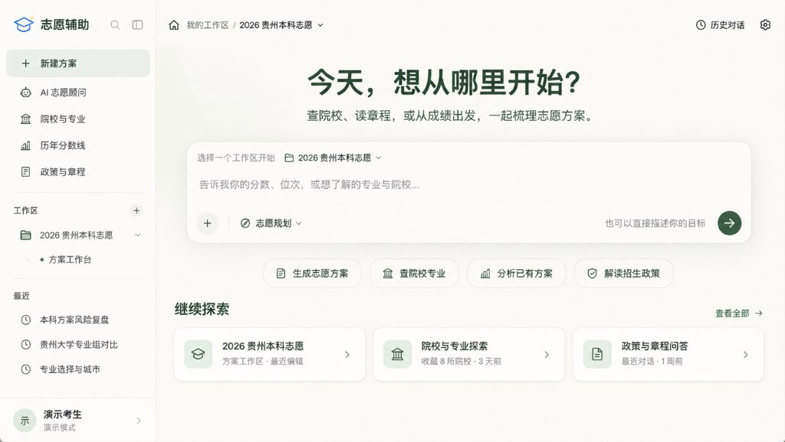
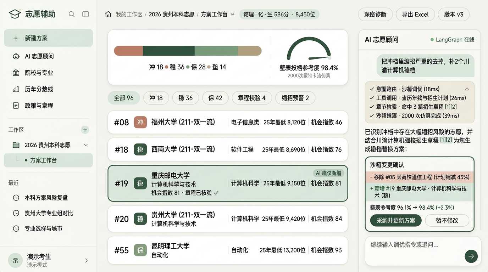
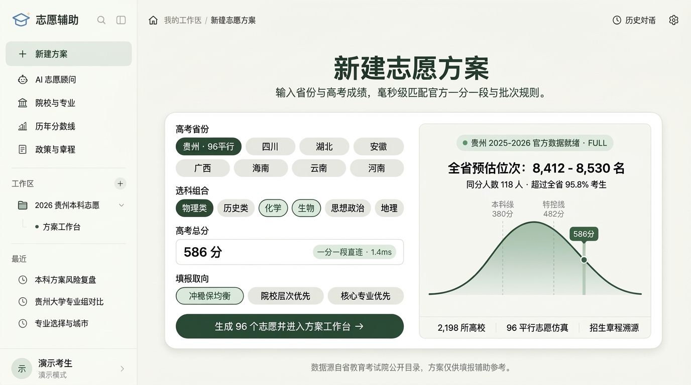
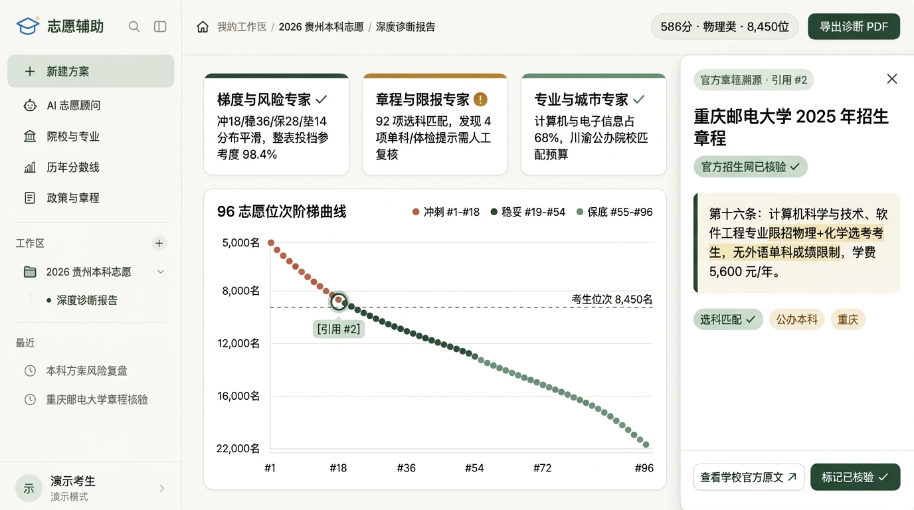
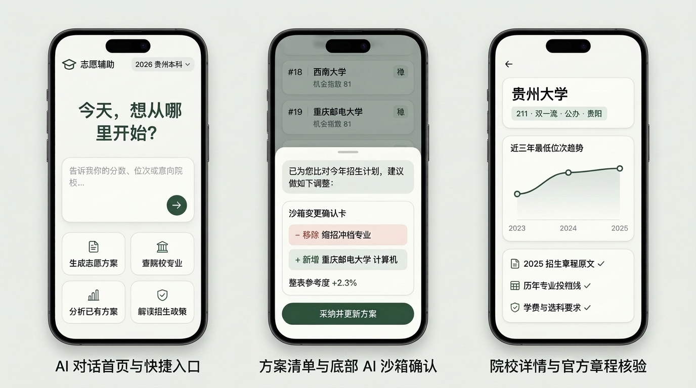

# 志愿辅助 GZGK v2.0 · 暖纸白 × 深森绿 AI-Native UI/UX 设计规范

> **视觉语言**：摒弃高饱和霓虹科技风与旧式表单门户，采用 **暖纸白画布（`#F7F8F5`）+ 暖象牙可折叠工作区侧边栏（`#FAFAF8`）+ 深森松绿主色（`#2D523A`）+ 低饱和编辑级语义色**，在高压高考志愿季营造沉静、克制、专业、可信赖的决策体验。  
> **当前落地范围**：`frontend/gzgk-web` 桌面/自适应 Web 端已全部实现并构建通过；移动端视觉稿保留作为下一阶段 `gzgk-app` 复用基线。

---

## 一、核心界面视觉稿预览

### 1. AI-First 工作区首页（`HomeView.vue`）

### 2. 双栏方案工作台：96 志愿虚拟列表 × LangGraph ReAct/MCP 副驾驶与 HITL 确认卡（`WorkbenchView.vue`）

### 3. 新建志愿方案：8 省选科切换 × 一分一段毫秒级森绿分布曲线（`NewPlanView.vue`）

### 4. Map-Reduce 三专家深度诊断报告 × 96 志愿位次阶梯曲线 × RAG 章程溯源抽屉（`DeepReportView.vue`）

### 5. 移动端随身工作台预留视觉稿（暂缓开发）

---

## 二、设计令牌（TailwindCSS Design Tokens）

定义于 `frontend/gzgk-web/tailwind.config.ts`：

| 语义角色 | Token | 色值 (Hex) | 应用场景 |
|---|---|---|---|
| **主画布背景** | `bg-paper` | `#F7F8F5` | 全局暖纸白底色 |
| **侧边栏背景** | `bg-sidebar` | `#FAFAF8` | 左侧 `240px` 可折叠导航、工作区树与历史会话 |
| **卡片表面** | `bg-white` | `#FFFFFF` | 悬浮卡片、输入框、表格行、抽屉（配 `1px solid #E5E8E2`） |
| **主品牌色（深森绿）** | `pine-700` | `#2D523A` | 主 CTA、圆形发送键、选中省份、曲线主线、HITL 确认外框 |
| **浅鼠尾草衬底** | `sage-100` | `#EAF0EB` | `+ 新建方案` 按钮、激活菜单、用户气泡、已核验徽标 |
| **主文字（深炭绿）** | `ink-900` | `#1E3326` | 标题与核心位次数据（数字强制 `tabular-nums` 等宽对齐） |
| **梯度 · 冲刺** | `terracotta-600` | `#C85A42` / `#FCF0EC` | 暖陶土红，用于「冲」档与缩招/移除行 |
| **梯度 · 稳妥** | `pine-700` | `#2D523A` / `#EAF0EB` | 深森松绿 |
| **梯度 · 保底** | `sage-500` | `#4F8A6B` / `#EDF6F0` | 鼠尾草绿 |
| **梯度 · 垫底** | `stonewarm-500` | `#6E7B72` / `#EAECE6` | 暖石灰 |
| **预警 · 核验** | `ochre-600` | `#B87D28` / `#FDF6E9` | 暖赭黄，用于单科/色觉/高学费人工复核提醒 |

---

## 三、合规文案硬约束（构建期自动门禁）

`frontend/gzgk-web/scripts/check-compliance.mjs` 在每次 `pnpm build` 前自动读取 `contracts/compliance-terms.json` 扫描全部 Vue/TS 源码：
- 统一使用 **「机会指数」「稳妥参考」「整表投档参考度」**；
- 严禁在任何页面文案或提示词中出现 39 项监管硬违禁词（`保录取`、`100%录取`、`录取概率`、`保证不滑档`、`稳上` 等）。
